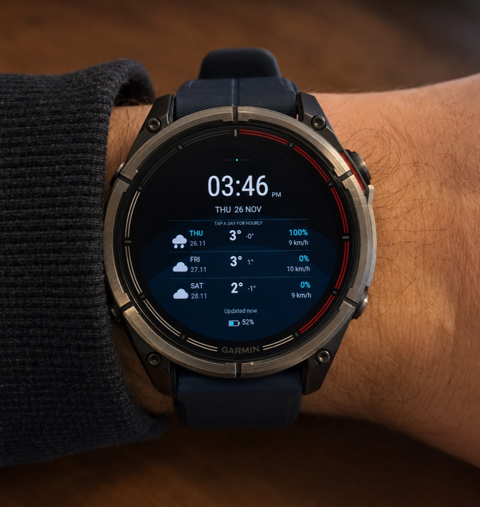
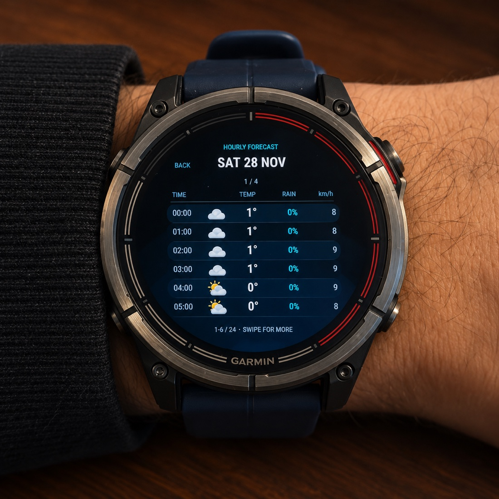

# Garmin Swiss Weather

An independent weather app for Garmin's **fēnix 8, tactix 8, and quatix 8 AMOLED watches in 47 mm and 51 mm sizes**. It has been tested on the **quatix 8 47 mm**; the other models share the same Garmin device target but have not yet been tested on hardware. The app shows the time, date, battery level, and a three-day forecast on a dark blue screen. A small glance shows today's temperature without opening the full app.

Tap a day to explore its hourly temperature, rain chance, wind speed, and weather symbols. Keep swiping to continue into the following days. The app saves the last forecast so you can still see it when the connection is unavailable.

## On the watch

  
  

Three-day overview and hourly detail, photographed on a quatix 8 47 mm.

This is a **watch app**, so you open it from Apps. It does not replace your normal watch face.

## Use the app

1. Open **MeteoSwiss Weather** on the watch. On first use, allow location access and keep the watch connected to your phone or Wi-Fi while it loads the forecast.
2. Tap a day to see the hourly forecast. You can also choose a day with **Up/Down** and press **Start**. Swipe or use **Up/Down** to move through the hours and into the next day. Press **Back** to return.
3. To refresh the forecast yourself, use the watch's **Menu** action on the main screen.
4. To add the glance, open the watch's glance list, choose **Edit → Add**, and select **MeteoSwiss Weather**.

The app normally updates when you open it. If it cannot connect, it shows the saved forecast and its age. A first forecast needs a watch location; later updates can use the saved location.

## Install a test build on quatix 8

You need a built `.prg` file. If you are building it yourself, follow [the developer instructions](DEVELOPMENT.md).

1. Connect the quatix 8 to your Mac with a USB data cable. On the watch, set **Watch Settings → System → Advanced → USB Mode → MTP**. Other supported watches may have a different USB menu path.
2. Open [OpenMTP](https://openmtp.ganeshrvel.com/) and find the watch's **GARMIN → Apps** folder.
3. Copy the built `MeteoSwissWeather-device.prg` into that folder. Wait for the transfer to finish, quit OpenMTP, and unplug the watch.
4. Open **MeteoSwiss Weather** from Apps on the watch.

An installed `.prg` may no longer be visible in OpenMTP after the watch processes it. You can copy a newer build into the same folder.

## Forecast source

**Forecast data: MeteoSwiss ICON-CH2 via Open-Meteo.** This app is independent and is not affiliated with MeteoSwiss or Garmin. It does not display official weather warnings. The weather artwork in this project is original.

## Development

Build, simulator, test, and GitHub publishing instructions are in [DEVELOPMENT.md](DEVELOPMENT.md). The code is available under the [MIT License](LICENSE).
